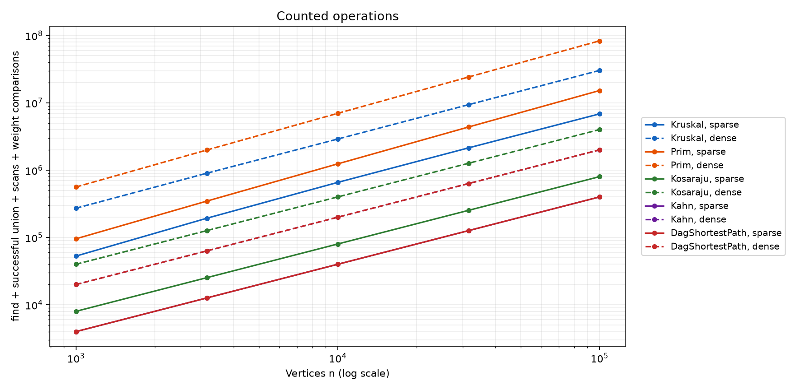
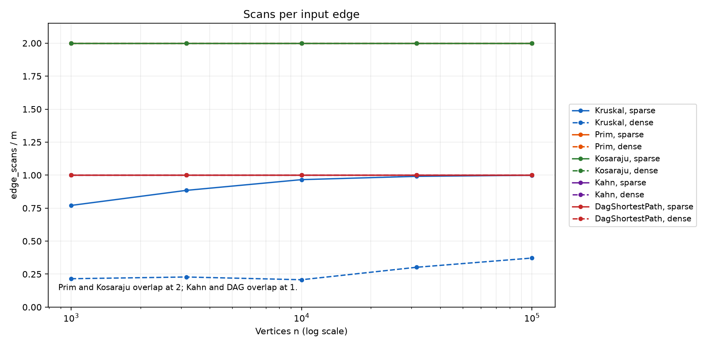
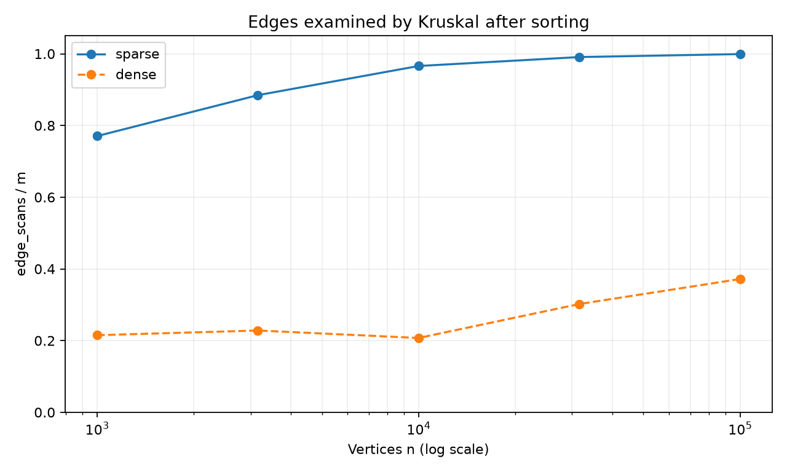

# Assignment 3: City Network and Job Scheduler

## 1. Implementation and experiment

The project uses one adjacency-list graph and ordinary Java collections. DSU has
union by size and full path compression. Kruskal sorts an edge-list copy; Prim
uses a lazy priority queue and restarts at unvisited vertices to produce a forest.
Kosaraju uses explicit integer stacks in both passes. Kahn copies cached in-degrees
and removes zero-degree vertices. DAG shortest paths first obtains a topological
order, sets every source to zero, and relaxes each edge once. Parent pointers
restore paths. Accumulated weights use `long`.

The experiment uses n = 1,000; 3,162; 10,000; 31,623; 100,000 and m = 4n or 20n.
Each combination has an undirected graph, an arbitrary directed graph and a DAG.
Every generator starts with a fresh `Random(42)`. The undirected generator first
shuffles vertices and adds a random spanning tree; the DAG generator shuffles
vertex ranks and orients edges toward larger ranks. When a random edge has equal
endpoints, only the second endpoint is drawn again. Weights are drawn after
choosing valid endpoints. This precise random-number order reproduces the table.
There are five runs per algorithm/input pair, with the median time saved.

Counters are defined precisely: `dsu_ops` is the number of public `find` calls plus
successful unions, including finds inside `union`. `comparisons` counts weight
comparator calls in sorting or the priority queue. `edge_scans` counts Kruskal's
candidate checks, Prim's adjacency visits, Kosaraju's two DFS passes, Kahn's queue
processing, or the DAG relaxation pass. Reverse-graph construction, cached
in-degree creation and independent validation are outside these scan counters.
DAG running time includes topological sorting, while its CSV scan counter covers
only relaxation, as required. `max_depth` is the largest occupied explicit DFS
stack, not the JVM call-stack depth. Other algorithms leave it at zero.

## 2. Complexity

Here V is the number of vertices and E the number of input edges. Space below is
additional space beyond the input graph and includes returned arrays/edges.

| Operation | Time | Extra space | Justification |
|---|---|---|---|
| DSU initialization | O(V) | O(V) | Initialize parent and size arrays. |
| DSU find/union | O(alpha(V)) amortized | O(1) per operation | Compression flattens paths; smaller trees attach to larger roots; arrays occupy O(V) overall. |
| Kruskal | O(V + E log(E+1)) | O(V+E) | Sort E edges, then perform at most E unions; initialize DSU for every vertex. |
| Prim, lazy heap | O(V + E log(E+1)) | O(V+E) | Scan adjacency entries once and insert/remove O(E) candidate edges. |
| Kosaraju | O(V+E) | O(V+E) | Two DFS passes and a reversed adjacency-list graph. |
| Kahn | O(V+E) | O(V) | Each vertex enters the queue once; each edge updates one in-degree. |
| DAG shortest paths | O(V+E) | O(V) | Topological sort plus one relaxation pass and parent/distance arrays. |

The heap bound uses log E because parallel edges are allowed and this Prim stores
edges rather than one heap entry per vertex. With a simple connected graph it is
also commonly written O(E log V). Isolated vertices explain the explicit V term.

## 3. Correctness

### Cut property and the two MST algorithms

Consider a cut that separates vertices into two sets without crossing a selected
forest edge. Let e be a minimum-weight edge crossing that cut. If an MST already
contains e, adding it to our chosen set is safe. Otherwise inserting e into the
MST creates a cycle, and that cycle contains another edge f crossing the cut.
Since weight(e) <= weight(f), replacing f with e preserves connectivity and never
increases the weight, so some MST contains the enlarged chosen set. Kruskal uses
DSU components as cuts and chooses the lightest edge connecting different
components; Prim uses the visited set as its cut and chooses its lightest outgoing
edge, so both repeatedly make safe choices, separately in every connected component.

### Induction over the topological order

Every edge of a DAG goes from an earlier vertex to a later vertex in a topological
order. Initially every source has distance zero, which equals adding a virtual
super-source with a zero-weight edge to each source. Assume the distances of all
previously processed vertices are already optimal. Before processing the next
vertex v, every possible predecessor has been processed and has relaxed its edge
into v, so the smallest incoming candidate gives the optimal distance to v.
Relaxing the outgoing edges of v therefore maintains the induction invariant,
and after one pass all distances are optimal. Negative weights are safe because
no edge can return to an earlier vertex, whereas a general graph may have cycles
requiring repeated relaxations or a reachable negative cycle with no finite optimum.

## 4. Validation and reference results

Eight JUnit test methods passed. They cover random DSU unions against simple set
labels; 100 connected graphs with equal Kruskal/Prim weights and V-1 edges; MST
weights against exhaustive subsets on 30 tiny graphs; SCC partitions against
mutual BFS reachability, including V=200; and 100 random DAGs against Bellman-Ford
with negative weights and shuffled vertex labels. Additional checks cover all
three input files, loops, parallel edges, an isolated vertex, forests, empty graphs,
cycles, restored paths and distances exceeding `int`. An explicit 100,000-vertex
path completes SCC with 100,000 components and maximum stack depth 100,000.

All benchmark reference triples matched. Each run also checks both MST structures,
MST agreement, topological validity, exact traversal scan counts and repeatable
results/counters across the five runs.

| n | m | MST weight | SCC count | Sum of DAG distances |
|---:|---:|---:|---:|---:|
| 1,000 | 4,000 | 147,970 | 27 | 396,274 |
| 1,000 | 20,000 | 30,363 | 1 | 252,411 |
| 3,162 | 12,648 | 468,911 | 137 | 1,271,911 |
| 3,162 | 63,240 | 97,589 | 1 | 723,157 |
| 10,000 | 40,000 | 1,486,139 | 373 | 3,941,828 |
| 10,000 | 200,000 | 309,550 | 1 | 2,381,342 |
| 31,623 | 126,492 | 4,715,515 | 1,188 | 12,551,891 |
| 31,623 | 632,460 | 968,517 | 1 | 7,376,612 |
| 100,000 | 400,000 | 15,012,094 | 3,923 | 40,096,539 |
| 100,000 | 2,000,000 | 3,056,681 | 1 | 23,512,087 |

## 5. Counters versus formulas

For MST algorithms the normalized value below is comparisons / (E log2 E).
For traversals it is edge_scans / (V+E). Ranges cover all five sizes in each density;
the complete fitted values are saved in `results/analysis.csv`.

| Algorithm | Sparse normalized range | Dense normalized range |
|---|---:|---:|
| Kruskal | 0.7447-0.9069 | 0.6662-0.9027 |
| Prim | 1.8291-1.9344 | 1.8248-1.8896 |
| Kosaraju | 1.6000-1.6000 | 1.9048-1.9048 |
| Kahn | 0.8000-0.8000 | 0.9524-0.9524 |
| DAG shortest paths | 0.8000-0.8000 | 0.9524-0.9524 |

Traversal ratios are exactly constant because Kosaraju scans 2E edges and Kahn
and DAG relaxation scan E. Prim scans 2E adjacency entries in an undirected graph.
MST comparison ratios stay in a bounded range, consistent with the sorting/heap
bounds; five sizes provide empirical support, not a mathematical proof.
Kruskal's `dsu_ops = 2 * edge_scans + successful_unions`; connected inputs have
V-1 successful unions. DSU call counts alone do not measure parent-pointer work
and cannot empirically prove alpha(V). Its amortized bound follows from the two
heuristics. Kruskal stops early once only one component remains, so its DSU/E
ratio need not be constant.

The first plot sums the three counted work fields: scans, weight comparisons and
DSU operations. Kahn and DAG relaxation overlap because their counted scans are
identical; this does not mean their complete running times are equal. Both
density series have E proportional to V; the assignment's "dense" family is 20V,
not a truly quadratic complete graph.

### Fitted log-log slopes

The slope is ordinary least squares on natural-log(n) and natural-log(counter),
with all five sizes and separate fits for each density.

| Algorithm | Scan slope, sparse/dense | Total counted work slope, sparse/dense |
|---|---:|---:|
| Kruskal | 1.0550 / 1.1194 | 1.0537 / 1.0219 |
| Prim | 1.0000 / 1.0000 | 1.1007 / 1.0850 |
| Kosaraju | 1.0000 / 1.0000 | 1.0000 / 1.0000 |
| Kahn | 1.0000 / 1.0000 | 1.0000 / 1.0000 |
| DAG shortest paths | 1.0000 / 1.0000 | 1.0000 / 1.0000 |

Sorting comparisons / E alone rise from 10.67 to 13.86 on sparse Kruskal inputs,
and from 12.90 to 13.95 on dense inputs. The scan slope is a separate quantity:
sorting does not increment `edge_scans`, so a log factor cannot be inferred from
that counter alone. Kruskal's scan slope is slightly above one here because its
examined fraction grows, not because sorting scans the input more times.
Weights are restricted to 1..1000 and Java sorting exploits data structure, so
finite-range fitted comparison slopes need not look exactly like unrestricted
E log E worst-case growth.

Kruskal examines 77.05%-99.92% of sparse edges but only 20.74%-37.18% of dense
edges in these runs. At V=100,000 and E=2,000,000, it examines 743,572 candidates;
Prim scans 4,000,000 adjacency entries and makes 79,103,986 heap comparisons,
against 27,890,128 sorting comparisons for Kruskal. Early stopping saves DSU work,
but all edges are still sorted. Sparse graphs can make Prim competitive because
its heap is smaller; the counters do not establish a universal winner.

## 6. Which algorithm when?

| Situation | Choice | Reason |
|---|---|---|
| Undirected weighted graph, edge list | Kruskal + DSU | Sorting the existing edge list is straightforward. |
| Sparse undirected graph, adjacency list | Prim | Grow from one vertex using available outgoing edges. |
| Very dense simple graph | Consider O(V^2) matrix Prim | Avoid many heap operations; this alternative is not implemented here. |
| Disconnected undirected network | Either MST implementation | Both return a minimum spanning forest and component count. |
| Directed graph, deadlocks/cycles possible | Kosaraju | SCCs group mutually reachable jobs; a singleton needs a self-loop to be cyclic. |
| Directed job dependencies | Kahn | Gives an executable order, or detects a cycle. |
| Weighted DAG, even with negative edges | DAG shortest paths | One relaxation pass after topological sorting. |
| General graph, nonnegative edges | Dijkstra | Topological ordering may not exist. |
| General graph, negative edges | Bellman-Ford | Repeated relaxation can also detect a reachable negative cycle. |

## 7. Time measurements

The recorded run used JDK 17 and Gradle 8.14.3. On the largest dense input the
median times were about 511 ms for Kruskal, 1,249 ms for Prim, 277 ms for Kosaraju,
52 ms for Kahn and 85 ms for DAG paths. Small cases varied irregularly: for
example sparse Kahn took about 0.824 ms at V=1,000 and 0.440 ms at V=3,162.
JIT compilation, allocation, garbage collection and background load explain why
these times are not complexity evidence. The timed callbacks also include small
result checks, and Kahn's callback includes order validation. There is no separate
warm-up, so the five-run median is only a descriptive measurement. The measured
counter ratios and independent correctness checks are the main conclusions;
another computer can have different timings without an algorithm error.
